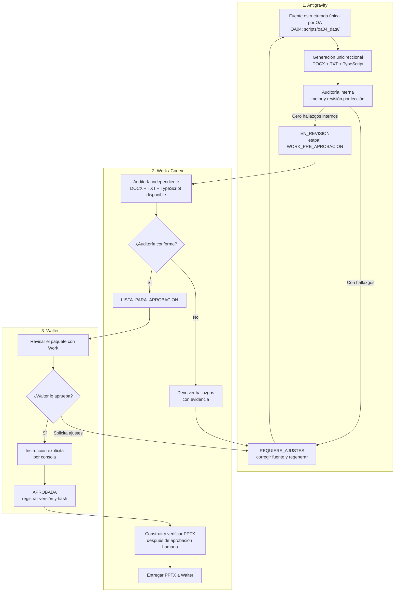

# Skill Oficial: Producción y Auditoría de Lecciones EstudioSimple (3° a 8° Básico)

Esta Skill establece las **reglas universales** y el **flujo general de producción pedagógica** para la creación, revisión y validación de lecciones en EstudioSimple para la totalidad de educación básica (3° a 8° básico). Los perfiles de curso y de asignatura agregan los criterios propios y específicos de su respectivo alcance. La Skill de coherencia ejecuta la auditoría utilizando estas reglas y perfiles oficiales; no debe crear criterios paralelos.

---

## 1. Declaración de Principios y Fuente Estructurada Única de Autoría

1. **Fuente Estructurada Única por OA:**
   Para cada Objetivo de Aprendizaje (OA), existe una **fuente estructurada única** definida por el proyecto (ej. `scripts/oa04_data/` para Matemática 7° OA04). Esta fuente estructurada contiene la totalidad de los datos didácticos, narrativas, reactivos psicométricos y prompts visuales.
2. **Generación Unidireccional Estricta:**
   El Plan Maestro oficial en DOCX (`Plan_Maestro_*.docx`), el guion TXT de prompts para Work y los módulos TypeScript interactivos en `Web Studio Simple/src/data/lessons/` se compilan o sincronizan **estrictamente en una sola dirección** a partir de dicha fuente estructurada.
   > 🛑 **PROHIBICIÓN TERMINANTE:** Queda estrictamente prohibido editar o parchear por separado los archivos derivados (DOCX, TXT o TypeScript). Toda modificación debe realizarse en la fuente estructurada única y propagarse mediante el script de construcción canónico.
3. **Rol de Presentaciones:**
   La carpeta `PLANES MAESTROS PRESENTACIONES/` es exclusivamente un catálogo de referencia visual para la maquetación en PowerPoint. Todo contenido didáctico emana de la lección oficial compilada desde la fuente estructurada.

---

## 2. Delimitación Estricta de Responsabilidades (Pipeline)

| Actor | Responsabilidad Obligatoria | Prohibiciones Estrictas |
| :--- | :--- | :--- |
| **Antigravity** | Mantener la fuente estructurada única, compilar unidireccionalmente el DOCX oficial, los prompts TXT y TypeScript, y ejecutar la auditoría interna automatizada con 0 hallazgos. Entregar el paquete en `EN_REVISION` (`WORK_PRE_APROBACION`). | **PROHIBIDO** generar o editar archivos PPTX finales. **PROHIBIDO** declarar `LISTA_PARA_APROBACION` o `APROBADA`. **PROHIBIDO** contar palabras o certificar duración acústica previa. |
| **Codex / ChatGPT Work** | **Fase Pre-Aprobación:** Auditar de forma independiente el flujo conceptual, redacción y correspondencia entre DOCX y TXT (PPTX aún no existe). **Fase Post-Aprobación:** Construir y verificar visualmente las presentaciones PPTX en Python en su propio entorno tras la aprobación de Walter. | No modifica objetivos ni ejercicios aprobados en el DOCX sin retroalimentar a la fuente estructurada. |
| **Walter** | Máxima autoridad y **único aprobador humano**. Analiza el paquete con Work y emite la orden de aprobación explícitamente por consola. | No aplica. |
| **Google Vids** | Grabar, sintetizar locución, generar subtítulos y sincronizar la duración acústica real durante la producción del video. | Ni Antigravity ni Codex imponen restricciones acústicas previas. |

---

## 3. Jerarquía y Organización de Reglas por Alcance

Las directivas están estrictamente ordenadas por ámbito de aplicación en los recursos de la Skill:

1. **Alcance Universal (Transversal 3° a 8° Básico):**
   Ver [rules/reglas_universales.md](rules/reglas_universales.md).
   - Estructura pedagógica de 8 etapas duales (Mentor / Estudiante).
   - **Parámetro Estándar de Cobertura por OA:** Exactamente **6 lecciones completas por Objetivo de Aprendizaje (OA)** (Directriz Work).
   - **Fuente Estructurada Única por OA:** Compilación unidireccional estricta hacia DOCX, TXT y TypeScript.
   - **Identidad de Ejercicios en 5 Dimensiones:** Contexto, datos y unidades, pregunta/intención, procedimiento esperado, respuesta correcta/retroalimentación, enlazando `caso1` y `caso2` entre práctica, D6 y `postQuestions`.
   - Todas las reglas universales (`UNI-001` a `UNI-015`) clasificadas como **BLOQUEANTES**.
   - Blindaje terminante anti-texto en arte IA (`No text drawn by AI`).
   - Puente análogo-digital con el cuaderno físico.
   - Honestidad epistemológica (atribución a fuentes oficiales).
   - Evaluación formativa sin marcas punitivas.

2. **Alcance por Curso y Nivel Evolutivo:**
   - **3° y 4° Básico (Primer Ciclo):** [profiles/cursos/perfil_3_4_basico.md](profiles/cursos/perfil_3_4_basico.md).
   - **5° y 6° Básico (Transición):** [profiles/cursos/perfil_5_6_basico.md](profiles/cursos/perfil_5_6_basico.md).
   - **7° Básico (Segundo Ciclo):** [profiles/cursos/perfil_7_basico.md](profiles/cursos/perfil_7_basico.md) (**Específico de 7°**: Estructura bimodal de 14 láminas [7 Gancho + 7 Explicación], protagonistas de 13 años [joven con trenzas y joven con chaqueta cerceta], y reactivos de 4 alternativas [A, B, C, D] con análisis psicométrico formal de distractores).
   - **8° Básico (Consolidación):** [profiles/cursos/perfil_8_basico.md](profiles/cursos/perfil_8_basico.md).
   *Nota Crítica:* Los requisitos de 14 láminas, 4 alternativas A-D y 13 años son específicos de 7° básico y **no deben generalizarse como universales**.

3. **Alcance por Asignatura:**
   - **Matemática:** [profiles/asignaturas/matematica.md](profiles/asignaturas/matematica.md) (Enfoque CPA, resolución Pólya, fórmula canónica $p\% = p \div 100$, subtítulos en 36 pt y progresión de OA04 Porcentajes).
   - **Ciencias Naturales:** [profiles/asignaturas/ciencias_naturales.md](profiles/asignaturas/ciencias_naturales.md) (Indagación científica empírica, subtítulos en 48 pt).
   - **Lengua y Literatura:** [profiles/asignaturas/lengua_literatura.md](profiles/asignaturas/lengua_literatura.md) (Comprensión multinivel, subtítulos en 48 pt).
   - **Historia, Geografía y Cs. Sociales:** [profiles/asignaturas/historia_geografia.md](profiles/asignaturas/historia_geografia.md) (Pensamiento histórico, erradicación de jerga matemática, subtítulos en 48 pt).
   - **Inglés (EFL):** [profiles/asignaturas/ingles.md](profiles/asignaturas/ingles.md) (Enfoque comunicativo funcional, subtítulos en 48 pt).

4. **Alcance por OA Específico y Consulta a la Base Curricular:**
   - Alineación obligatoria con `TEMARIOS EELL/`, el texto escolar respectivo y la base curricular local:  
     `INSUMOS/BASE_CURRICULAR/EstudioSimple_Base_Curricular_7B_4Asignaturas_v1.json`.
   - Consulta obligatoria de fragmentos, fuentes, indicadores y auditoría vinculados al OA.
   - **Distinción entre Unidades de Contenido y Clases:** Las unidades de contenido (`C01`, `C02`, etc.) agrupan núcleos temáticos en la base; no equivalen mecánicamente a los números de clase (`CLASE 01`, etc.). Cada clase se define según la planificación vigente del proyecto.
   - **Correspondencia Oficial de Identificadores:**
     * Nivel: `7B` en base $\longleftrightarrow$ `110-7` en App/editor.
     * `7B-LYL-OA03` $\longleftrightarrow$ `110-7/Lengua_Literatura/OA03`.
     * `7B-CNA-OA01` $\longleftrightarrow$ `110-7/Ciencias_Naturales/OA01`.
     * `7B-HIS-OA02` $\longleftrightarrow$ `110-7/Historia_Geografia/OA02`.
     * `7B-ING-OA09` $\longleftrightarrow$ `110-7/Ingles/OA09`.

---

## 4. Secciones Obligatorias de una Lección (Modelo Universal Dual)

Cada lección construida para EstudioSimple debe implementar de forma exhaustiva y ordenada las siguientes secciones en su esquema `LessonData` y archivo Markdown:

1. **`metadata`:** Identificación formal (`grade`, `subject`, `oaCode`, `oaTitle`, `lessonNumber`, `totalLessonsInOa`, `lessonTitle`, `durationMinutes`, `nextLessonTitle`).
2. **`prep` (Paso 1 - Preparación del Mentor):** `adultObjective`, `routeToday`, `mentorReminder`, `reminders` (4 consejos obligatorios), `emotionalTip`.
3. **`route` (Paso 2A - Ruta de Aprendizaje):** `blocks` (4 bloques temáticos con id, número, título, subtítulo, color), `keyQuestions` (2 preguntas clave con bajada), `dileIntro`, `dileObjective`.
4. **`situation` & `reference` (Paso 2B - Situación Inicial y Punto de Partida):**
   - En `situation`: `dilePrompt`, `expectedAnswer`, `socraticHint`, `emotionalTip`, y `options` con retroalimentación para respuesta correcta (`correct`), necesidad de apoyo (`needs_support`) y ausencia de respuesta (`no_answer`).
   - En `reference`: pregunta de observación concreta y criterios de retroalimentación (`feedbackSuccess`, `feedbackSupport`).
5. **`hook` (Paso 3 - Video Gancho y Diapositivas):**
   - Metadatos del gancho: `title`, `dileIntro`, `hazInstruction`, `videoSrc`, `focusPoints`, `dileAfterVideo`.
   - **14 Láminas Bimodales:** Exactamente 7 de gancho contextual + 7 de explicación formal, con `visualPrompt` (`No text drawn by AI`), overlay tipográfico y guion completo de notas al orador (`speakerNotes`).
6. **`preQuestions` (Paso 4 - Conversación Guiada):** Items guiados socráticos posteriores al video (`context`, `question`, `expected`, `success`, `support`, `reveal`, `studentReveal`).
7. **`formalization` (Paso 5 - Explicación e Idea Clave):** Consolidación conceptual (`title`, `concept`, `ideaClave`, `dileIntro`, `hazInstruction`, esquema o láminas).
8. **`postQuestions` (Paso 5B - Comprobación de Formalización):** Items guiados que comprueban inmediatamente la formalización.
9. **`practice` (Paso 6 - Práctica Conjunta y Cuaderno):** Mínimo dos casos (`caso1` y `caso2`) con identidad en 5 dimensiones articulados con el cuaderno físico.
10. **`mini` (Paso 7 - Miniquiz de Evaluación Formativa):** Exactamente 3 preguntas de **4 alternativas (A, B, C, D)** con una respuesta correcta, distractores pedagógicos plausibles y explicación correctiva (`fixExplain`).
11. **`recovery` (Paso 7B - Recuperación Formativa):** Reactivos de refuerzo coherentes con los errores evaluados en el miniquiz.
12. **`summaryIdeas` & `paso8_cierre` (Paso 8 - Síntesis y Cierre):** Ideas clave de recapitulación, `preguntaSintesis`, `metacognicion`, y `celebracion` con proyección a la siguiente clase.

---

## 5. Procedimiento de Guardado e Incorporación al Editor

1. **Módulo TypeScript en la App:**
   - Escribir la lección como módulo tipado en `Web Studio Simple/src/data/lessons/<asignatura>_7b_<oa>_clase<nn>.ts`.
   - Registrar la lección en [Web Studio Simple/src/data/lessons/index.ts](Web Studio Simple/src/data/lessons/index.ts) sin generar duplicados.
2. **Archivo Markdown y Manifiesto Canónico:**
   - Generar el archivo `.md` de la lección en `LECCIONES/110-7/<Asignatura>/<OA>/CLASE<NN>_YYYY-MM-DD_HH-mm.md`.
   - Actualizar el `manifest.json` del OA con `status: "EN_REVISION"`, `etapa_revision: "WORK_PRE_APROBACION"`.
3. **Entrega de Borradores para Revisión:**
   - La lección queda accesible inmediatamente en el reproductor/editor interactivo de la App.
   - Dejar la copia idéntica del archivo `.md` en la ruta correspondiente para revisión de Work.

---

## 6. Condiciones de la Tarea Actual (Entrega Inicial 4 Clases)

- **Alcance Específico:** Construcción de **Clase 01** para:
  1. Lengua y Literatura: OA03 (Clase 01).
  2. Ciencias Naturales: OA01 (Clase 01).
  3. Historia, Geografía y Cs. Sociales: OA02 (Clase 01).
  4. Inglés: OA09 (Clase 01).
- **Exclusión:** Matemática queda excluida de esta entrega puntual (no constituye una restricción permanente de 7° básico).
- **Estado Normativo:** Todas las clases quedan registradas en `EN_REVISION` (`WORK_PRE_APROBACION`). Prohibido marcar autónomamente `APROBADA`.
