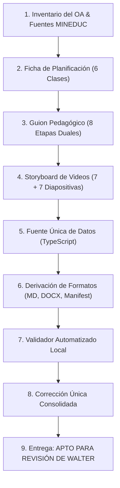

# Sistema Global de Lecciones EstudioSimple v2.0 (Estructura Global Común)

## 1. Propósito y Alcance Curricular
- **Propósito:** Establecer la arquitectura pedagógica, curricular, técnica y de control de calidad para planificar, producir y verificar las lecciones de EstudioSimple, garantizando alineación estricta con las Bases Curriculares y Temarios Oficiales de Exámenes Libres (EELL) del MINEDUC (Chile), articulando la plataforma web con el cuaderno físico del estudiante y la mediación del adulto en el hogar.
- **Alcance Curricular:** Exclusivamente los niveles de **3.° a 8.° Básico** de Educación General Básica. No se extiende a 1.° ni 2.° Básico ni a Enseñanza Media.
- **Distribución de Asignaturas:** Cinco módulos disciplinares (Matemática, Lengua y Literatura, Inglés [5°-8°], Ciencias Naturales, Historia y Geografía). Se aplica un módulo a un nivel dado únicamente si la asignatura figura en el temario oficial respectivo.

## 2. Autoridad de las Fuentes por Dominio
Para resolver discrepancias sin contradicciones, rige la siguiente autoridad por materia:
1. **Alcance, entregables y reglas invariables:** Fijados por las instrucciones maestras del proyecto.
2. **Texto literal del OA, contenidos, habilidades y exigencias curriculares:** Fijados por el currículo oficial y el temario vigente de Exámenes Libres del MINEDUC. El texto del OA es inmutable; no se simplifica ni se reescribe.
3. **Secuencia de seis clases, subobjetivos, mediación y requisitos pedagógicos de un OA:** Fijados por el Plan Maestro vigente del OA y el Manual Maestro, subordinados a las reglas invariables.
4. **Rótulos y orden visibles en la aplicación:** Fijados por la captura oficial de la interfaz con las ocho etapas invariables.
5. **Ejecución del proceso técnico:** Guiada por las skills vigentes de Antigravity en la medida que no contradigan los niveles superiores.
6. **Informes anteriores y entregables previos:** Evidencia de consulta para localizar problemas; no constituyen autoridad para alterar decisiones aprobadas.

## 3. Flujo Canónico de Trabajo


## 4. Planificación Progresiva de Seis Clases por OA
- Todo OA se planifica de forma obligatoria en **exactamente seis clases completas**.
- Queda prohibido unir, dividir, agregar o eliminar clases.
- Cada clase posee un **subobjetivo específico** articulado y una **evidencia de aprendizaje observable** propia que avanza progresivamente en complejidad taxonómica.

## 5. Las Ocho Etapas Invariables de Cada Clase
Cada clase se compone estrictamente de las siguientes ocho etapas secuenciales en este orden y con estos rótulos exactos:

```
[Antes de comenzar] (Preparación previa del adulto mentor - No es una etapa numerada)
  1. Inicio
  2. Video Motivacional  (7 diapositivas)
  3. Recorrido
  4. Video Explicativo   (7 diapositivas)
  5. Práctica
  6. Resumen
  7. Miniquiz
  8. Cierre
```

Queda estrictamente prohibido renombrar, reordenar, fusionar, dividir o eliminar cualquiera de estas etapas.

## 6. Formato de Videos Audiovisuales (7 + 7 Diapositivas)
- **Etapa 2 (Video Motivacional):** Contiene el video gancho de la lección con **exactamente 7 diapositivas**. Presenta el dilema o situación cotidiana sin revelar la explicación formal.
- **Etapa 4 (Video Explicativo):** Contiene el video formal de modelamiento con **exactamente 7 diapositivas**. Desarrolla el concepto, modela el caso en diapositiva 6 y cierra con la regla de oro en diapositiva 7.
- **Total audiovisual:** **14 diapositivas por clase**, pertenecientes exclusivamente a esos dos videos. No representan la clase completa; las otras seis etapas transcurren en la plataforma y el cuaderno físico.

## 7. Adaptación al Nivel Escolar (3.° a 8.° Básico)
La adaptación curricular no altera la estructura de ocho etapas ni los conteos de diapositivas:
- **Complejidad y lenguaje:** Vocabulario y densidad textual ajustados evolutivamente (apoyo concreto en 3°-4°; mayor abstracción y formalismo en 7°-8°).
- **Dúo co-protagónico:** Personajes con apariencia de ~9-10 años en primer ciclo y de ~13 años en segundo ciclo (7° y 8° básico).
- **Tratamiento visual:** Prohibido texto dibujado por IA (`No text drawn by AI` en todas las láminas).

## 8. Coordinación Dual: Estudiante vs Adulto Mentor
Cada etapa desglosa obligatoriamente dos perspectivas coordinadas:
- **Experiencia del estudiante:** Consignas, lecturas, visualizaciones y actividades en cuaderno.
- **Guía del adulto responsable:** Indicaciones operativas directas utilizables sin formación pedagógica previa:
  - `DILE:` Lo que el adulto verbaliza textualmente.
  - `ESPERA:` Lo que debe observar o esperar (si la fuente fija tiempo, se consigna; si no, se indica "esperar la respuesta del estudiante" sin inventar segundos).
  - `SI RESPONDE BIEN:` Refuerzo positivo inmediato.
  - `SI NECESITA APOYO:` Pistas y andamiaje formativo gradual.

## 9. Formato y Funcionalidad de las Etapas
1. **Inicio:** Encuadre de la clase dentro de la secuencia (ej. Clase 1 de 6), foco pedagógico, activación de saberes previos y ruta visual de la sesión.
2. **Video Motivacional:** 7 diapositivas. Despierta curiosidad. Instrucciones previas y comprobación posterior fuera del video.
3. **Recorrido:** Etapa independiente entre ambos videos. Conversación e indagación socrática (pregunta, respuesta esperada, pista gradual y retroalimentación).
4. **Video Explicativo:** 7 diapositivas. Desarrollo conceptual, modelamiento en diapositiva 6 y síntesis en diapositiva 7. Comprobaciones posteriores fuera del video.
5. **Práctica:** Ejercitación aplicada en pantalla y **cuaderno físico del estudiante**, alineada con el subobjetivo.
6. **Resumen:** Síntesis fiel de las ideas clave efectivamente enseñadas, sin introducir materia nueva.
7. **Miniquiz:** Exactamente 3 preguntas formales de selección múltiple. Al menos 2 aciertos para aprobar. Bucle de recuperación formativa no punitiva ante reprobación.
8. **Cierre:** Metacognición sobre la estrategia usada, felicitación y transferencia a la siguiente sesión.

## 10. Controles de Calidad y Tolerancias
- **Crítico (Tolerancia 0):** Error factual, OA o fuente inventada, fuga de clave privada, etapas alteradas, diapositivas != 7. Bloquea.
- **Mayor (Tolerancia 0):** Falta de guía del adulto, conteo u orden erróneo, miniquiz incompleto, prompt sin cláusula anti-texto. Bloquea.
- **Menor (Tolerancia hasta 3):** Detalle tipográfico secundario o ajuste estético aislado sin impacto pedagógico.
- **Pendiente de fuente:** Falta de evidencia verificable. Impide declarar apto si afecta un criterio esencial.

## 11. Gobernanza de Aprobación
Antigravity no aprueba lecciones ni altera estados a `APROBADA`. Todo paquete evaluado concluye con uno de estos estados:
- **`APTO PARA REVISIÓN DE WALTER`**: Cero críticos, cero mayores y hasta 3 menores aislados documentados.
- **`NO APTO`**: Mantiene $\ge 1$ crítico/mayor o excede el margen de menores.
- **`PENDIENTE DE FUENTE`**: Imposibilidad de comprobar por falta de insumo.
*La aprobación final es potestad exclusiva de Walter tras análisis con ChatGPT Work.*
