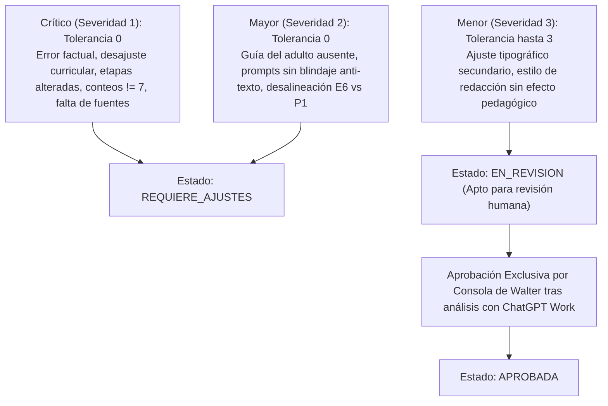

# MAPA DE APLICABILIDAD DE REGLAS
## EstudioSimple — Sistema Global de Lecciones v2.0

Este mapa multidimensional define la matriz de aplicabilidad del catálogo de 47 reglas normativas a través de cuatro dimensiones de control:
1. **Dimensión de Nivel Escolar** (3.° a 8.° Básico)
2. **Dimensión de Asignatura** (5 Áreas Disciplinares)
3. **Dimensión de Etapa de la Clase** (8 Etapas Oficiales)
4. **Dimensión de Objetivo de Aprendizaje (OA)**

---

## 1. Matriz por Nivel Escolar (3.° a 8.° Básico)

| Nivel | Reglas Universales Aplicables | Reglas Específicas de Nivel | Reglas Disciplinares Aplicables |
| :---: | :--- | :--- | :--- |
| **3.° Básico** | UNI-001 a UNI-017 (17 reglas) | Adaptación 3B: Lenguaje concreto, andamiaje alto, personajes ~9 años | MAT, LYL, CIE, HIS |
| **4.° Básico** | UNI-001 a UNI-017 (17 reglas) | Adaptación 4B: Lenguaje concreto, andamiaje guiado, personajes ~10 años | MAT, LYL, CIE, HIS |
| **5.° Básico** | UNI-001 a UNI-017 (17 reglas) | Adaptación 5B: Transición a operaciones formales, personajes ~11 años | MAT, LYL, CIE, HIS, ING |
| **6.° Básico** | UNI-001 a UNI-017 (17 reglas) | Adaptación 6B: Consolidación primer ciclo, personajes ~12 años | MAT, LYL, CIE, HIS, ING |
| **7.° Básico** | UNI-001 a UNI-017 (17 reglas) | **7B-001** (14 láminas), **7B-002** (Títulos 64pt / Subtítulos 48/36pt), **7B-003** (4 opciones A-D psicométricas) | MAT, LYL, CIE, HIS, ING |
| **8.° Básico** | UNI-001 a UNI-017 (17 reglas) | Adaptación 8B: Estructura bimodal 14 láminas, 4 opciones A-D psicométricas | MAT, LYL, CIE, HIS, ING |

---

## 2. Matriz por Asignatura

| Asignatura | Código Reglas | Alcance y Excepciones |
| :--- | :---: | :--- |
| **Matemática** | `MAT-01` a `MAT-05` (5) | CPA obligatorio, recálculo exacto, 36 pt en expresiones algebraicas complejas (`7B-002`), IVA 19% (`MAT-05`). |
| **Lengua y Literatura** | `LYL-01` a `LYL-05` (5) | Cita y atribución canónica, comprensión multinivel (explícito, inferencial, crítico), rúbricas abiertas (`LYL-04`). |
| **Idioma Extranjero: Inglés** | `ING-01` a `ING-05` (5) | Delimitación estricta: Español en guía del mentor vs Inglés en inputs del estudiante (`ING-05`), naturalidad sintáctica. |
| **Ciencias Naturales** | `CIE-01` a `CIE-06` (6) | Fuentes SM/médicas, esquemas vectoriales limpios (`CIE-02`), prohibición de diagnósticos personales (`CIE-04`), 4 dimensiones. |
| **Historia, Geografía y Cs. Sociales** | `HIS-01` a `HIS-06` (6) | Convención cronológica uniforme (`HIS-01`), mapas históricos precisos, multicausalidad y erradicación del anacronismo (`HIS-04`). |

---

## 3. Matriz por Etapa de la Clase (8 Etapas Obligatorias)

| N.° | Etapa Oficial | Reglas Específicas Aplicables | Requisitos Obligatorios |
| :---: | :--- | :--- | :--- |
| **0** | *Antes de comenzar* | `UNI-011` | Preparación previa del mentor (materiales, cuaderno, clima de acogida). No es etapa numerada. |
| **1** | **Inicio** | `UNI-007`, `UNI-011` | Ubicación en secuencia de 6 clases, activación de conocimientos previos, ruta de sesión, guía dual. |
| **2** | **Video Motivacional** | `UNI-001`, `UNI-002`, `UNI-003`, `UNI-004`, `UNI-012`, `7B-001`, `7B-002` | **Exactamente 7 diapositivas**. Co-protagonistas visibles, `No text drawn by AI`, sin revelar la fórmula final. |
| **3** | **Recorrido** | `UNI-009`, `UNI-011` | Etapa interactiva independiente. Indagación con preguntas, respuestas esperadas, pistas y refuerzos. |
| **4** | **Video Explicativo** | `UNI-001`, `UNI-002`, `UNI-003`, `UNI-004`, `UNI-005`, `UNI-010`, `UNI-013`, `7B-001`, `7B-002` | **Exactamente 7 diapositivas**. Diapositiva 6: Modelamiento explícito paso a paso (*caso1*). Diapositiva 7: Regla de oro. |
| **5** | **Práctica** | `UNI-005`, `UNI-008`, `UNI-011`, Reglas Disciplinares | Isomorfismo estricto: Ejercicio 1 idéntico en estructura a Diapositiva 6. Ejercitación en **cuaderno físico**. |
| **6** | **Resumen** | `UNI-010`, `UNI-011` | Síntesis fiel de lo enseñado y practicado; prohibido introducir contenidos o definiciones no vistas. |
| **7** | **Miniquiz** | `UNI-006`, `7B-003`, Reglas Disciplinares | **Exactamente 3 preguntas**. Aprobación $\ge 2/3$. Bucle de recuperación formativa no punitiva ante reprobación. |
| **8** | **Cierre** | `UNI-011` | Metacognición sobre estrategias de aprendizaje, refuerzo positivo y transferencia a la siguiente clase. |

---

## 4. Matriz de Severidad y Gobernanza

