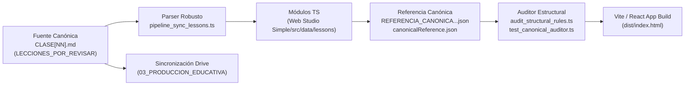

# MANUAL MAESTRO DE CONSTRUCCIÓN DE LECCIONES CANÓNICAS
## Metodología Pedagógica, Estructural y Técnica · EstudioSimple (7° Básico)
**Versión del documento:** v2.0 (Consolidada a octubre de 2026)  
**Autor:** Antigravity (Google DeepMind) en articulación con Dirección General EstudioSimple (Walter)  
**Destinatarios:** Equipo de Pedagogía, Desarrolladores de Software, Diseñadores Curriculares y Auditores Independientes (ChatGPT)  
**Estado Normativo:** `DOCUMENTO_NORMATIVO_OFICIAL · VIGENTE`

---

## 1. PROPÓSITO Y FILOSOFÍA DEL SISTEMA CANÓNICO

El sistema de lecciones de **EstudioSimple** está concebido como una experiencia de aprendizaje científico, formativo y reflexivo de alta calidad para estudiantes de **7° Básico (Curso 110-7)** en modalidad de educación en el hogar (*homeschooling*) y preparación de **Exámenes Libres** del Ministerio de Educación de Chile (MINEDUC).

### Principios Fundamentales
1. **Unidad orgánica integral (Cero parches):** Una lección no es un conjunto de fragmentos sueltos pegados en una plantilla. Cada clase se construye desde sus fuentes curriculares oficiales como un discurso coherente, progresivo y auto-contenido.
2. **Rol del Mentor:** La lección no asume que el estudiante está solo frente a una pantalla; estructura la interacción entre el **estudiante** y un **mentor/apoderado** a través de indicaciones claras (`DILE`, `PREGÚNTALE`, `MODELO`), fomentando el diálogo socrático guiado.
3. **Discurso oral cercano y empático:** Se prohíbe el copiado literal de objetivos curriculares en infinitivo (`"Describir..."`, `"Distinguir..."`) dentro de las indicaciones de voz dirigidas al alumno. El mentor se comunica en segunda persona (`"¡Hola! Hoy exploraremos..."`), explicando el valor vital del aprendizaje.
4. **Blindaje ético y salvaguarda de la intimidad:** Las actividades, preguntas y debates emplean **estrictamente casos didácticos ficticios**. Está terminantemente prohibido solicitar a los estudiantes confidencias o relatos sobre su propio cuerpo, orientación, relaciones afectivas, vivencias familiares o secretos íntimos.
5. **Rigor psicométrico:** Los instrumentos formativos (miniquiz) no recurren a distractores absurdos ni a preguntas triviales. Evalúan concepciones erróneas reales y ofrecen retroalimentación diferenciada por cada alternativa (A, B, C, D), complementándose con rutas deterministas de recuperación ante el error.

---

## 2. JERARQUÍA DE AUTORIDAD Y FUENTES CURRICULARES

Antes de escribir cualquier lección, la información debe rastrearse y validarse en el siguiente orden de precedencia inmutable:

```
[1. Gobierno Curricular Unificado] ──► Reglas corporativas y soberanía de aprobación (Walter).
               ↓
[2. Plan Maestro Global de Lecciones 7° v1.2] ──► Arquitectura universal de 8 pasos y contratos U01-U14.
               ↓
[3. Plan Maestro Disciplinar Vigente] ──► Reglas específicas de la materia (Ciencias v3.4, Historia, etc.).
               ↓
[4. Plan Maestro Global de Presentaciones v3.2] ──► Estándar bimodal 7+7, paleta y tipografía.
               ↓
[5. Fuentes Curriculares Oficiales] ──► Bases Curriculares MINEDUC y Temarios de Exámenes Libres.
               ↓
[6. Textos Escolares Oficiales] ──► Edición MINEDUC / SM (cita obligatoria de página impresa y PDF físico).
```

> [!WARNING]
> Los archivos PPTX antiguos, copias locales no rastreadas o archivos de borradores previos no tienen autoridad normativa. Si existe contradicción entre una fuente histórica y el Plan Maestro vigente, prevalece siempre el Plan Maestro.

---

## 3. ARQUITECTURA ESTRUCTURAL CANÓNICA DE 26 SECCIONES

Toda lección canónica se redacta en formato Markdown (`CLASE[NN].md`) y contiene **exactamente las 26 secciones canónicas** auditadas por el validador estructural:

```markdown
# Encabezado Principal y Metadatos Documentales
1.  ## 7° básico · [Asignatura] · [OA] · Clase [NN]
2.  ### Objetivo oficial de aprendizaje
3.  ### Objetivo de esta clase
4.  ### Alcance
5.  ## 1. Paso 1 — Preparación del mentor
6.  ## 2. Paso 2A — Ruta de aprendizaje
7.  ## 3. Paso 2B — Situación inicial y punto de partida
8.  ### Recurso de lectura visible para el estudiante
9.  ## 4. Paso 3 — Videos de la clase: Motivación y Explicación
10. ## 5. Paso 4 — Conversación guiada
11. ### Pregunta 1
12. ### Pregunta 2
13. ### Pregunta 3
14. ## 6. Paso 5 — Explicación y modelamiento
15. ### Razonamiento científico visible que modela la clase:
16. ### Ejemplo modelado paso a paso para mostrar al estudiante:
17. ## 7. Paso 6 — Práctica conjunta y autónoma
18. ### Caso 1 (Práctica guiada)
19. ### Caso 2 (Práctica guiada)
20. ### Aplicación autónoma y transferencia (Estímulo nuevo)
21. ## 8. Paso 7 — Miniquiz y recuperación
22. ### Reactivo 1
23. ### Reactivo 2
24. ### Reactivo 3
25. ### Recuperación formativa posterior al error (para puntajes 0/3 o 1/3)
26. ## 9. Paso 8 — Síntesis y cierre
    [Secciones de Cierre y Control: Trazabilidad, Guiones Audiovisuales y Control de Revisión]
```

---

## 4. DESGLOSE PASO A PASO: LOS 8 MOMENTOS PEDAGÓGICOS

### Paso 1 — Preparación del Mentor
- **Propósito:** Brindar al apoderado o tutor el marco conceptual, ético y pedagógico de la lección antes de interactuar con el estudiante.
- **DILE:** Discurso oral del mentor al estudiante. Debe ser empático, hablado en 2ª persona y motivador. **Prohibido colocar objetivos en infinitivo.**
- **Ruta de hoy:** Resumen breve en 4 momentos comunicables al estudiante.
- **Pautas para el mentor:** 3 a 4 indicaciones de acompañamiento, delimitando el foco y recordando la protección de la intimidad.

### Paso 2A — Ruta de Aprendizaje
- **Distribución de tiempos orientativos (30 minutos en total):**
  - Inicio, lectura y punto de partida: 5 min.
  - Proyección audiovisual (Motivación y Explicación): 4 min.
  - Conversación guiada y modelamiento: 8 min.
  - Práctica conjunta y transferencia autónoma: 8 min.
  - Miniquiz de salida y retroalimentación formativa: 5 min.

### Paso 2B — Situación Inicial y Punto de Partida
- **Recurso de lectura visible:** Síntesis rigurosa del Texto Escolar con cita de páginas impresas y de PDF físico. Expone los conceptos ancla.
- **Caso didáctico ficticio:** Situación simulada de adolescentes en entornos escolares, familiares o comunitarios cotidianos.
- **Punto de partida:** Pregunta de activación reflexiva que conecta la lectura con el caso.
- **Respuesta de referencia:** Respuesta modelo, privada para el mentor hasta después del primer intento del estudiante.

### Paso 3 — Videos de la Clase: Motivación y Explicación
- Breve orientación de visualización que conecta con los dos recursos audiovisuales de la lección:
  - **Video 1 (Motivación):** Presenta el problema o dilema sin revelar la solución teórica.
  - **Video 2 (Explicación):** Desarrolla el concepto formal mediante modelos visuales paso a paso.

### Paso 4 — Conversación Guiada
- **Estructura fija de 3 preguntas socráticas:**
  - `Pregunta 1`: Localización y recuperación directa de evidencia desde el recurso.
  - `Pregunta 2`: Interpretación, contraste y análisis crítico de la situación.
  - `Pregunta 3`: Transferencia valórica o actitudinal hacia la convivencia y el autocuidado.
- Cada pregunta incluye su **Contexto**, la locución **PREGÚNTALE**, la **Respuesta esperada** privada para el mentor y pautas de andamiaje si el estudiante duda.

### Paso 5 — Explicación y Modelamiento
- **Concepto focal disciplinar:** Enunciado central de la lección.
- **Ciclo de Razonamiento Científico / Indagación (6 etapas explícitas):**
  1. *Pregunta inicial / Problema científico.*
  2. *Evidencia observable / Datos recopilados.*
  3. *Representación / Criterio estructurante.*
  4. *Explicación fundamentada del modelo.*
  5. *Conclusión científica transferible.*
  6. *Comunicación respetuosa y ética.*
- **Ejemplo modelado paso a paso:** Un caso nuevo analizado con los 4 pasos del procedimiento frente al alumno (*"Yo hago, tú observas"*).
- **Error conceptual frecuente y cómo corregirlo:** Misconception típica de 7° básico contrastada con la corrección basada en la evidencia.
- **Comprobación inmediata:** Pregunta rápida de chequeo de comprensión antes de pasar a la práctica, con su respectivo modelo de respuesta.

### Paso 6 — Práctica Conjunta y Autónoma
- **Caso 1 (Práctica guiada):** Ejercicio con andamiaje (`Recurso` → `Consigna` → `Procedimiento` → `Modelo para revisar después del intento`).
- **Caso 2 (Práctica guiada):** Segundo ejercicio con menor intervención del mentor.
- **Aplicación autónoma y transferencia (Estímulo nuevo):**
  - `Recurso nuevo visible para el estudiante`: Escenario ficticio inédito.
  - `Actividad autónoma del estudiante`: Tarea para el cuaderno en 2 a 3 consignas.
  - `Criterio privado del mentor (revelar solo después del intento)`: Solución formal esperada.
  - `Cómo valorar`: Pauta para evaluar el logro del estudiante sin ambigüedades.

### Paso 7 — Miniquiz y Recuperación
- **Criterio psicométrico formativo:** 3 preguntas de opción múltiple con 4 alternativas (A, B, C, D) y una sola clave correcta. Aprobación formativa con 2/3 o 3/3.
- **Estructura de cada Reactivo:**
  - Enunciado desafiante contextualizado.
  - Alternativas etiquetadas `- A.`, `- B.`, `- C.`, `- D.`.
  - `Clave privada:` [A–D].
  - `Explicación formativa:` Fundamentación disciplinar del porqué la clave es correcta.
  - `Análisis de distractores:` Explicación pedagógica individualizada para cada una de las 4 opciones, indicando qué error de razonamiento representa.
- **Módulo de Recuperación posterior al error (para puntajes 0/3 o 1/3):**
  - Dividido en 3 subsecciones dedicadas: `Recuperación para Reactivo 1`, `2` y `3`.
  - Cada una contiene:
    1. *Enseñanza del error:* Desmonta el malentendido específico.
    2. *Pista orientadora:* Estrategia para enfocar la atención.
    3. *Recurso visible nuevo:* Mini-caso o dato complementario.
    4. *Tarea nueva del estudiante:* Ejercicio guiado de aplicación.
    5. *Apoyos progresivos (1, 2 y 3).*
    6. *Pregunta de reintento (con 4 alternativas y clave privada).*

### Paso 8 — Síntesis y Cierre
- **Tres ideas fuerza para recordar:** Síntesis conceptual en viñetas directas.
- **Pregunta metacognitiva final:** Pregunta orientada a la autorregulación del aprendizaje (*"¿Qué estrategia usaste hoy...?"*).
- **Puente hacia la siguiente clase:** Enlace de continuidad hacia el título exacto de la clase siguiente (o cierre formal del OA si es la última clase).

---

## 5. ARQUITECTURA AUDIOVISUAL BIMODAL (7+7 DIAPOSITIVAS)

Cada clase cuenta con dos guiones de producción para presentaciones visuales y videos explicativos:
1. **MOTIVACION.pptx:** 7 diapositivas (duración objetivo: ~60 segundos).
2. **EXPLICACION.pptx:** 7 diapositivas (duración objetivo: ~90 segundos).
**Total por lección:** Exactamente 14 láminas estructuradas.

```
┌───────────────────────────────────────┬───────────────────────────────────────┐
│        MOTIVACION (7 Láminas)         │        EXPLICACION (7 Láminas)        │
├───────────────────────────────────────┼───────────────────────────────────────┤
│ 01. Un caso cotidiano / Dilema        │ 01. Objetivo formal de aprendizaje    │
│ 02. Identificación del conflicto      │ 02. Marco conceptual o esquema ancla  │
│ 03. La mirada superficial/errónea     │ 03. Evidencia y análisis disciplinar  │
│ 04. Indagación de pistas              │ 04. Desarrollo del modelo científico  │
│ 05. Organización de factores          │ 05. Valores, convivencia y aplicación │
│ 06. La perspectiva integral           │ 06. Trascendencia y generalización    │
│ 07. Pregunta abierta hacia la clase   │ 07. Síntesis y puente a la práctica   │
└───────────────────────────────────────┴───────────────────────────────────────┘
```

### Reglas Gráficas y Audiovisuales Obligatorias:
- **Títulos no genéricos:** Queda terminantemente prohibido usar títulos como `Una situación`, `Una herramienta`, `El criterio`, `Relación entre pistas`, `Modelo explicado`, `Comprobación` o `Error y corrección`. Cada lámina debe llevar un título sustantivo representativo del contenido (ej.: *La brújula del crecimiento*, *La trampa de los filtros digitales*).
- **Tipografía y Colores:**
  - *Título en lámina:* Arial negrita, 64 pt, color blanco (`#FFFFFF`), centrado.
  - *Subtítulo en lámina:* Arial negrita, 32 pt, color amarillo oro (`#FFD32C`), centrado.
  - *Fondo:* Imágenes completas a 16:9 widescreen, sin recuadros opacos, sombras artificiales ni degradados que tapen los personajes.
- **Erradicación del término legacy:** La palabra `"gancho"` está prohibida en todo el ecosistema (cero apariciones). Se utiliza siempre `MOTIVACION`.
- **Locución en off:** Escrita en texto continuo, con puntuación precisa para sincronización de voz, desprovista de música de fondo estridente.

---

## 6. PIPELINE TÉCNICO Y AUTOMATIZACIÓN EN EL REPOSITORIO

La arquitectura de software de EstudioSimple opera mediante un pipeline determinista unidireccional:



### 1. El Parser (`pipeline_sync_lessons.ts`):
- Extrae metadatos documentales de cabecera (`courseId`, `grade`, `subjectName`, `oaCode`, `lessonNumber`, `lessonTitle`, `nextLessonTitle`).
- Analiza secciones delimitadas por expresiones regulares rigurosas:
  - Paso 1 (`prep.adultObjective`, `routeToday`, `mentorReminder`).
  - Paso 3 (`hook.slides` y `formalization.slides`, validando exactamente 7+7 diapositivas).
  - Paso 5B (`postQuestions`: Comprobación inmediata).
  - Paso 6 (`practice`: Caso 1, Caso 2 y Aplicación autónoma con estímulo nuevo).
  - Paso 7 (`mini`: 3 preguntas con claves privadas A–D y `recovery`: 3 ítems con reintentos).
  - Paso 8 (`summaryIdeas`, `metacognición`, `nextClassPreview`).

### 2. Cadena de Custodia Criptográfica (`canonical_lesson_reference.ts`):
- Registra el hash **SHA-256** de cada fuente Markdown y de cada manifiesto.
- Valida la **continuidad de títulos**: el `nextLessonTitle` de la Clase $N$ debe coincidir exactamente con el `lessonTitle` de la Clase $N+1$.
- Mantiene sincronizados los archivos de referencia:
  - Auditor (servidor): `docs/auditorias/REFERENCIA_CANONICA_TITULOS_CONTINUIDAD.json`
  - Cliente (web): `Web Studio Simple/src/data/canonicalReference.json`

### 3. Mecanismo de Blindaje (`PROTEGIDO_NO_INTERVENIDO`):
- Las clases aprobadas y congeladas (como **Matemática OA01** y las presentaciones de **Lengua OA03**) cuentan con una cláusula de exclusión en todos los scripts compartidos. Jamás se modifican, renombran ni sobrescriben sin orden explícita de Walter.

### 4. Compilación del Front-End:
- `npm run build --prefix "Web Studio Simple"` ejecuta previamente `node ../scripts/verify_editor_reference.cjs` para asegurar que el bundle de producción nunca se compile con referencias desactualizadas o inconsistentes.

---

## 7. PROTOCOLO OPERATIVO EN GOOGLE DRIVE

La producción educativa se sincroniza directamente con el Drive oficial de EstudioSimple (`estudiosimplechile@gmail.com`):

### Jerarquía Oficial de Carpetas
```
EstudioSimple_Repositorio_Curricular (1IfuMjCS_iGyP1jd1TPKK2vKahCqT7mc9)
├── 01_GOBIERNO_CURRICULAR (Manuales maestros y normativas)
├── 02_INSUMOS_CURRICULARES (Bases curriculares y libros PDF)
├── 03_PRODUCCION_EDUCATIVA (1cvj33bu4xIiKoTWAOEtXN3XSVYRTM2vM)  <-- DESTINO OFICIAL
│   └── 110-7 / [Asignatura] / [OA] /
│       ├── CLASE01/ (CLASE01.md, MOTIVACION.pptx, EXPLICACION.pptx)
│       ├── CLASE02/ (CLASE02.md, MOTIVACION.pptx, EXPLICACION.pptx)
│       └── ...
├── 04_RECURSOS_VISUALES (Personajes maestros)
├── 05_CONTROL_DE_CALIDAD (Estructuras de auditoría e históricas)
├── 06_SISTEMAS_TECNICOS
└── 99_HISTORICO (Backups y versiones anteriores)
```

### Reglas de Operación con la CLI `gdrive`:
1. **Actualización *In-Place*:** Usar siempre `gdrive mutate update [fileID] [localPath]` para modificar los archivos `.md`. Esto preserva el ID único de Google Drive, los enlaces compartidos y el historial de versiones, evitando duplicados.
2. **Preservación de Binarios:** No sobrescribir ni tocar las presentaciones `.pptx` ya existentes en Drive al actualizar lecciones Markdown.
3. **Verificación de Retorno:** Tras subir una versión a Drive, se descarga con `gdrive readonly download` a una carpeta temporal y se calcula su hash SHA-256 para comprobar paridad absoluta con el archivo local.

---

## 8. PLANTILLA CANÓNICA MODELO (BOILERPLATE)

Al iniciar la redacción de una nueva lección, debe utilizarse la siguiente plantilla base asegurando la completitud de sus campos:

```markdown
# EstudioSimple | Lección interactiva

## 7° básico · [Asignatura] · [OA] · Clase [NN]

**Curso App:** 110-7  
**Asignatura App:** [Nombre_Asignatura]  
**Código curricular:** 7B-[SIGLA]-[OA]  
**Título:** [Título sustantivo oficial de la clase]  
**Duración:** 30 minutos  
**Número de clase:** [NN] de [Total]  
**Título de trabajo de la siguiente clase:** [Título de la siguiente clase o 'Fin del objetivo de aprendizaje']  
**Estado:** EN_REVISION · NO INTEGRADA EN APP · NO APROBADA  
**Fuente principal:** Texto Escolar de [Asignatura] 7° básico (Edición MINEDUC / SM), páginas [XX] a [YY].  
**Unidades de contenido:** 7B-[SIGLA]-[OA]-C[NN].  
**Indicadores priorizados:** 7B-[SIGLA]-[OA]-IE[XX], en el alcance correspondiente a esta clase.

### Objetivo oficial de aprendizaje
[Texto oficial del OA ministerial]

### Objetivo de esta clase
[Propósito formativo específico de la lección redactado en lenguaje claro]

### Alcance
[Límites temáticos y advertencia ética de uso de casos ficticios]

---

## 1. Paso 1 — Preparación del mentor
**Propósito:** [Guía conceptual para el adulto]  
**DILE:** “[Saludo cordial y planteamiento motivador en 2ª persona. Prohibido infinitivos]”  
**Ruta de hoy:** [Paso A → Paso B → Paso C → Paso D]  
**Pautas para el mentor:**  
1. [Pauta de acompañamiento]  
2. [Pauta conceptual]  
3. [Resguardo de privacidad]

---

## 2. Paso 2A — Ruta de aprendizaje
[Descripción de la ruta y distribución de tiempos orientativos]

---

## 3. Paso 2B — Situación inicial y punto de partida
### Recurso de lectura visible para el estudiante
[Síntesis rigurosa del libro de texto con citas explícitas]

### Caso didáctico ficticio
[Situación simulada con personajes adolescentes respetuosos]

**Punto de partida:** [Pregunta detonante]  
**Respuesta de referencia:** [Respuesta esperada privada para el mentor]

---

## 4. Paso 3 — Videos de la clase: Motivación y Explicación
[Orientaciones breves de visualización bimodal]

---

## 5. Paso 4 — Conversación guiada
### Pregunta 1 — [Eje temático]
- **Contexto:** [Situación]  
- **PREGÚNTALE:** [Pregunta oral socrática]  
- **Respuesta esperada:** [Modelo conceptual privado]

### Pregunta 2 — [Eje temático]
...
### Pregunta 3 — [Eje temático]
...

---

## 6. Paso 5 — Explicación y modelamiento
**Concepto focal disciplinar:** [Definición central]

### Razonamiento científico visible que modela la clase:
1. **Pregunta inicial:** ...
2. **Evidencia:** ...
3. **Representación:** ...
4. **Explicación del modelo:** ...
5. **Conclusión científica:** ...
6. **Comunicación respetuosa:** ...

### Ejemplo modelado paso a paso para mostrar al estudiante:
- **Paso 1:** ...  
- **Paso 2:** ...  
- **Paso 3:** ...  
- **Paso 4:** ...

**Comprobación inmediata:**
- *Pregunta:* “[Pregunta de chequeo de comprensión]”
- *Modelo de respuesta:* “[Respuesta esperada comprobable]”

---

## 7. Paso 6 — Práctica conjunta y autónoma
### Caso 1 (Práctica guiada)
- **Recurso:** ...
- **Consigna:** ...
- **Procedimiento:** ...
- **Modelo para revisar después del intento:** “...”

### Caso 2 (Práctica guiada)
- **Recurso:** ...
- **Consigna:** ...
- **Procedimiento:** ...
- **Modelo para revisar después del intento:** “...”

### Aplicación autónoma y transferencia (Estímulo nuevo)
- **Recurso nuevo visible para el estudiante:**
  [Caso inédito de transferencia]
- **Actividad autónoma del estudiante:**
  [Consignas para el cuaderno de trabajo]
- **Criterio privado del mentor (revelar solo después del intento):**
  [Solución esperada]
- **Cómo valorar:** [Criterio de logro pedagógico]

---

## 8. Paso 7 — Miniquiz y recuperación
**Criterio formativo:** 3 preguntas con 4 alternativas (A, B, C, D) y clave privada única...

### Reactivo 1
[Enunciado desafiante de opción múltiple]
- A. ...
- B. ...
- C. ...
- D. ...

**Clave privada:** [A-D].  
**Explicación formativa:** [Fundamentación disciplinar de la respuesta correcta]  
**Análisis de distractores:**  
- *A es incorrecta:* [Motivo pedagógico / concepción errónea]  
- *B es CORRECTA:* [Validación con fuente]  
- *C es incorrecta:* [Motivo pedagógico]  
- *D es incorrecta:* [Motivo pedagógico]

### Reactivo 2
...
### Reactivo 3
...

### Recuperación formativa posterior al error (para puntajes 0/3 o 1/3)
#### Recuperación para Reactivo 1 ([Concepto])
- **Enseñanza del error:** ...
- **Pista orientadora:** ...
- **Recurso visible nuevo:** ...
- **Tarea nueva del estudiante:** ...
- **Apoyos progresivos:**
  * *Apoyo 1:* ...
  * *Apoyo 2:* ...
  * *Apoyo 3:* ...
- **Pregunta de reintento (Reintento 1):**
  [Pregunta de reintento con opciones A-D y clave privada]

#### Recuperación para Reactivo 2 ([Concepto])
...
#### Recuperación para Reactivo 3 ([Concepto])
...

---

## 9. Paso 8 — Síntesis y cierre
**Tres ideas fuerza para recordar:**
1. ...
2. ...
3. ...

**Pregunta metacognitiva final:**  
“[Pregunta formativa de autorregulación]”

**Puente hacia la siguiente clase:**  
[Texto de transición conectando con el título de la siguiente clase o cierre del OA]

---

## Trazabilidad y entrega
- **Código de entrega:** 110-7-[SIGLA]-[OA]-CLASE[NN]  
- **Versión pedagógica:** v3.4 canónica y unificada.  
- **Responsable de aprobación final:** Walter (EstudioSimple).  
- **Condición normativa:** EN_REVISION · NO INTEGRADA EN APP · PENDIENTE APROBACIÓN WALTER.

---

## Guiones audiovisuales de producción
### MOTIVACION: 110-7-[SIGLA]-[OA]-CLASE[NN]-MOTIVACION.pptx
#### Diapositiva 01 — [Título disciplinar]
**Título:** ...  
**Subtítulo:** ...  
**Texto en lámina:** Título Arial negrita 64 pt blanco (#FFFFFF) centrado; Subtítulo Arial negrita 32 pt amarillo (#FFD32C) centrado.  
**Descripción visual:** ...  
**Locución (Voz en off):** ...  
[Diapositivas 02 a 07]

### EXPLICACION: 110-7-[SIGLA]-[OA]-CLASE[NN]-EXPLICACION.pptx
#### Diapositiva 01 — [Título disciplinar]
...
[Diapositivas 02 a 07]

---

## Control de esta revisión y contrato pedagógico
- **Auditoría de cumplimiento:** ...
- **Validación estructural:** 26 secciones canónicas, erradicación de terminología obsoleta, bimodalidad 7+7 diapositivas con títulos de contenido no genéricos, psicometría rigurosa y recuperación determinista.
- **Estado de producción:** EN_REVISION · PENDIENTE APROBACIÓN WALTER.
```

---
*Manual oficial del Sistema Canónico de EstudioSimple · Octubre 2026*

