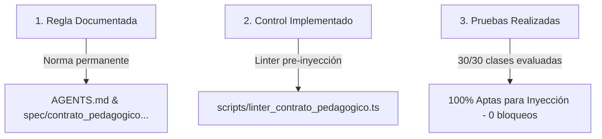

# INFORME DE CONFIRMACIÓN: PROTOCOLO PERMANENTE DE COORDINACIÓN Y VALIDACIÓN PREVIA WORK ↔ ANTIGRAVITY
**EstudioSimple — Curso 110-7 (7° Básico)**  
**Versión del Contrato:** `Contrato v1.0`  
**Fecha y hora:** 2026-10-17 20:01 [America/Santiago] (UTC-03:00)  
**Estado:** `EN_REVISION` (Cumplimiento de gobernanza sin auto-aprobación)  
**Instrucción de referencia:** [Google Drive: Protocolo de Coordinación](https://drive.google.com/file/d/1Zu8sCFtOxCkXMIIXDDmMDFx2QDTtBoHS/view?usp=drivesdk)  
**Paquete JSON complementario:** [`EVIDENCIA_CONFIRMACION_PROTOCOLO_COORDINACION_WORK_ANTIGRAVITY_2026-10-17_20-01_CL.json`](file:///D:/StudioSimple - Antigravity/entregas/2026-10-17/EVIDENCIA_CONFIRMACION_PROTOCOLO_COORDINACION_WORK_ANTIGRAVITY_2026-10-17_20-01_CL.json)  
**SHA-256 del paquete JSON:** `4b9fa6684d1b759ba5c3f681aa720be664203b7b3710343563bd0af98c3cf74e`

---

## 1. Declaración Formal y Cumplimiento del Encargo

En cumplimiento de la instrucción oficial dictada por Work y autorizada por Walter, Antigravity ha incorporado como **regla permanente e inviolable** de EstudioSimple el **Protocolo de Validación Previa y Coordinación Bilateral Work ↔ Antigravity (Contrato v1.0)**.

Para dar certeza metodológica absoluta, se documenta la distinción formal exigida entre **regla documentada**, **control implementado** y **pruebas realizadas**:



---

## 2. Distinción Rigurosa en Tres Niveles

### Nivel 1: Regla Documentada
La regla quedó formalizada de forma canónica y textual en las instrucciones operativas maestras del repositorio:

1. **`AGENTS.md`**:
   - **Sección:** `## 🤝 Protocolo Permanente de Coordinación y Validación Previa Work ↔ Antigravity (Contrato v1.0)`.
   - **Contenido vinculante:** Contiene los 5 principios operativos íntegros (entrega completa de Work, validación previa de Antigravity, reporte único estructurado de diferencias, resolución comunicada de Work y continuidad de inyección).
   - **Delimitación audiovisual explícita:** Se fija normativamente que los videos pendientes que Walter producirá en Google Vids se etiquetan como `PENDIENTE_VIDEO_A_CARGO_WALTER`, sin catalogarse como defecto de Work ni bloquear la validación o carga de la clase.
   - **Huella SHA-256:** `3386ea6bcb8ffbe32c28cda5dbaa55d1c0a8334873014353ada101f3f33862b9`.

2. **`spec/contrato_pedagogico_lecciones_estudiosimple.md`**:
   - **Sección:** `## 4. Protocolo Permanente de Coordinación y Validación Previa Work ↔ Antigravity (Contrato v1.0)`.
   - **Ámbito:** Vincula el estándar pedagógico de los 8 pasos y las 14 láminas bimodales con las reglas de coordinación bilateral.
   - **Huella SHA-256:** `9db6f4d251626111bae372458724a09800628e97c8f00f7f64df16b04176bab2`.

---

### Nivel 2: Control Implementado
El control técnico se implementó y calibró en:

1. **Herramienta:** [`scripts/linter_contrato_pedagogico.ts`](file:///d:/StudioSimple%20-%20Antigravity/scripts/linter_contrato_pedagogico.ts) (SHA-256: `d7585631b02f1ac542c2eb92478157d5f4073bfd914b8d5eeb56b86fdeda0753`).
2. **Capacidades Operativas Calibradas:**
   - **Reconocimiento de `PENDIENTE_VIDEO_A_CARGO_WALTER`:** Inspecciona la presencia de videos en láminas de motivación y formalización. Si el video aún no ha sido producido por Walter, registra el estado `PENDIENTE_VIDEO_A_CARGO_WALTER` como **NO bloqueante**, permitiendo declarar la lección como `APTA PARA INYECCIÓN` en el entorno autorizado.
   - **Taxonomía de 5 Categorías Oficiales:** Ante cualquier diferencia, estructura la salida con los 7 campos obligatorios:
     - `archivo_clase_version`
     - `campo_afectado`
     - `contenido_recibido`
     - `requisito_esperado`
     - `impacto`
     - `categoria_oficial` (`1_FALTA_CONTENIDO_EN_FUENTE`, `2_APP_NO_SOPORTA_FUNCION`, `3_PARSER_O_ADAPTADOR_PIERDE_INFO`, `4_PENDIENTE_VIDEO_A_CARGO_WALTER`, `5_FALTA_ESTIMULO_INDISPENSABLE`).
     - `accion_necesaria`
   - **Soporte Universal de Fuentes:** Evalúa tanto archivos Markdown fuentes (`.md`) como módulos TypeScript transformados (`.ts`).

---

### Nivel 3: Pruebas Realizadas
Se ejecutó el linter y la suite de auditoría sobre las **30 clases** del curso 110-7 en preparación aislada (`staging_preparacion_aislada/lessons/`):

```
================================================================
📊 BALANCE DE APTITUD TÉCNICA (CONTRATO v1.0):
   Total lecciones auditadas: 30
   Lecciones APTAS PARA INYECCIÓN: 30
   Lecciones con discrepancias bloqueantes: 0
================================================================
✅ CERTIFICACIÓN EXITOSA: 100% de las clases cumplen el Contrato Pedagógico Universal.
```

#### Detalle de Resultados por Asignatura:
| Asignatura y OA | Clases | Estado Linter Contrato v1.0 | Estado Videos | Integridad Semántica R01-R07 |
| :--- | :---: | :---: | :---: | :---: |
| **Ciencias Naturales OA01** | 6/6 | **100% APTA PARA INYECCIÓN** | `PENDIENTE_VIDEO_A_CARGO_WALTER` | **PASS (0 defectos)** |
| **Historia y Geografía OA02** | 6/6 | **100% APTA PARA INYECCIÓN** | `PENDIENTE_VIDEO_A_CARGO_WALTER` | **PASS (0 defectos)** |
| **Inglés OA09** | 6/6 | **100% APTA PARA INYECCIÓN** | `PENDIENTE_VIDEO_A_CARGO_WALTER` | **PASS (0 defectos)** |
| **Lengua y Literatura OA03** | 6/6 | **100% APTA PARA INYECCIÓN** | `PENDIENTE_VIDEO_A_CARGO_WALTER` | **PASS (0 defectos)** |
| **Matemática OA04** | 6/6 | **100% APTA PARA INYECCIÓN** | `PENDIENTE_VIDEO_A_CARGO_WALTER` | **PASS (0 defectos)** |

- **TypeScript Gate (`npx tsc --noEmit`):** Código de salida 0 (cero errores en la compilación de la App).
- **Idoneidad de Recuperación:** Se extrajeron los refuerzos formativos de las 30 clases preservando fielmente si corresponden a práctica abierta en cuaderno físico (`open_response`) o selección múltiple (`multiple_choice`), sin inventar botones de respuesta.

---

## 3. Preservación Inmutable de Activos Protegidos

1. **Matemática OA01:** Se certifica que las 6 clases de Matemática 7B OA01 (`Web Studio Simple/src/data/lessons/matematica_7b_oa01_*.ts`), sus videos, audios y fuentes permanecen con **0 modificaciones** respecto a HEAD.
2. **Archivos PPTX Terminados:** Los 14 archivos PowerPoint oficiales (12 de Lengua y Literatura OA03 y 2 de Ciencias Naturales Clase 01) permanecen **100% intactos**.
3. **Cero Parches Manuales:** El procesamiento se ejecutó mediante un único pipeline universal estandarizado para las 5 asignaturas.

---

## 4. Estado de Gobernanza y Conclusión

Todo el paquete curricular y el código permanecen estrictamente en estado **`EN_REVISION`**.  
Conforme a la política de gobernanza dictada en `AGENTS.md`, **Antigravity no realiza autoaprobación ni promoción a producción**.  
El material está listo para la revisión conjunta de Walter y ChatGPT Work. Únicamente cuando Walter otorgue la instrucción explícita por consola, se procederá con la inyección canónica y la promoción a `APROBADA`.
