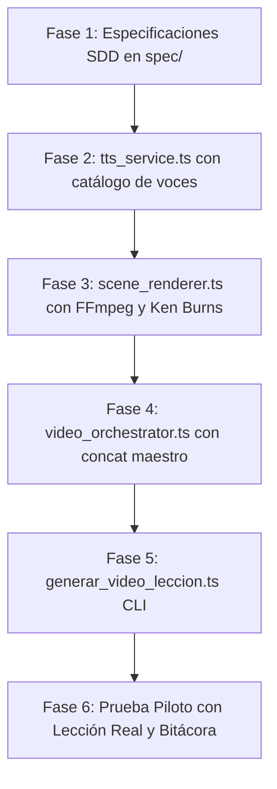

# Plan de Implementación: 002_slide_to_video_generator

## 🚀 Fases del Workflow (Grafo DAG)

## 📂 Dependencias y Archivos Afectados
- **Nuevos Archivos a Crear:**
  - `scripts/video_engine/types.ts`
  - `scripts/video_engine/tts_service.ts`
  - `scripts/video_engine/scene_renderer.ts`
  - `scripts/video_engine/video_orchestrator.ts`
  - `scripts/video_engine/generar_video_leccion.ts`
  - `scripts/video_engine/test_sample_lesson.ts`
- **Dependencias de Sistema y Entorno:**
  - `ffmpeg` (instalado en PATH).
  - `msedge-tts` (instalado en `package.json`).
- **Riesgo:** Bloqueos de archivos en Windows si FFmpeg no cierra los descriptores de entrada/salida (mitigado con manejo de procesos hijos y buffers temporales aislados).
